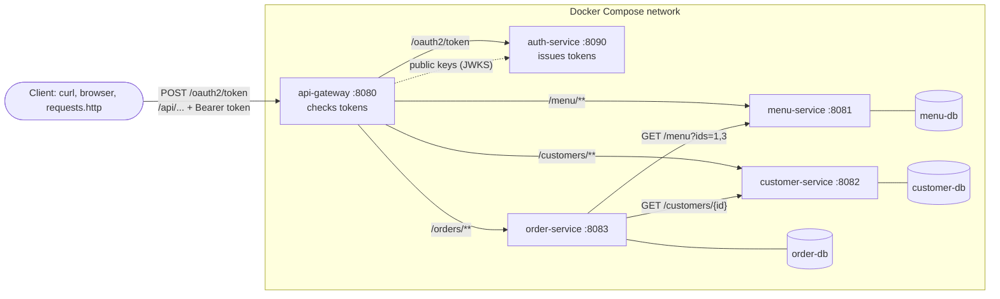

# Campus Canteen: REST microservices in Java

A small, working microservices system for teaching. Five Spring Boot services talk to
each other over REST and run together with Docker Compose. The domain is a campus
canteen: a menu, customers and orders. It is a tiny version of the FTGO food delivery
example in Chris Richardson's *Microservices Patterns* (Manning, 2018).

The repo follows the four parts of the Microservices lecture: **defining**, **securing**,
**testing** and **deploying** microservices. Each part has a short section below and a
longer page in `docs/`. [docs/SLIDES.md](docs/SLIDES.md) walks the deck slide by slide and
says what to open or run for each slide. For a hands-on class session, follow
[docs/LAB.md](docs/LAB.md).

Use it to learn:

1. how to build a REST API with Spring Boot (controller, service, repository, validation, errors);
2. how one service calls another over REST, and what to do when that call fails;
3. how the pieces become a system: API gateway, security service, database per service,
   health checks, containers;
4. how to secure, test and ship it: OAuth 2.0 tokens, contract tests, an integration test
   with a real database, images in a registry.

It is a boilerplate, not a product. The code is short on purpose.

## Architecture



- Clients talk only to the **API gateway** on port 8080. It forwards `/api/menu/**`,
  `/api/customers/**` and `/api/orders/**` to the right service and removes `/api`.
- The gateway also checks **access tokens**. Reading the menu is public; everything else
  needs a token from **auth-service**, which clients fetch through the gateway too
  (`POST /oauth2/token`).
- **order-service** is the only service that calls others. To place an order it asks
  customer-service "does this customer exist?" and asks menu-service for all the items
  in **one** batch request (`GET /menu?ids=1,3`), not one request per item.
- Each business service has its **own PostgreSQL database**. No service reads another
  one's tables.

| Service | Port | Owns | Endpoints |
|---|---|---|---|
| api-gateway | 8080 | routing, token checks | `/api/**`, `/oauth2/token`, `/actuator/gateway/routes` |
| auth-service | 8090 | clients, signing keys | `POST /oauth2/token`, `GET /oauth2/jwks` |
| menu-service | 8081 | menu items | `GET /menu`, `GET /menu?ids=1,2,3`, `POST /menu`, `GET/PUT/DELETE /menu/{id}` |
| customer-service | 8082 | customers | `POST /customers`, `GET /customers`, `GET /customers/{id}` |
| order-service | 8083 | orders | `POST /orders`, `GET /orders`, `GET /orders/{id}` |

Ports 8081-8083 and 8090 are published only for debugging (actuator, Swagger UI). Real
clients go through the gateway.

## What you need

- **JDK 21**, for example Eclipse Temurin 21. Check with `java -version`.
- **Docker** with Compose v2 (Docker Desktop on Windows and macOS). Check with `docker compose version`.
- **curl** (included in Windows 10+, macOS and Linux).
- You do **not** need to install Maven. The Maven Wrapper (`mvnw`, `mvnw.cmd`) downloads
  the right version the first time you run it.
- Optional: IntelliJ IDEA or VS Code. [requests.http](requests.http) works with the
  IntelliJ HTTP Client and the VS Code "REST Client" extension.

## Run it

```bash
./mvnw -q package -DskipTests          # 1. build the five jars
docker compose up -d --build --wait    # 2. build the images, start 8 containers, wait until healthy
scripts/smoke.sh                       # 3. check that everything works, end to end
```

On Windows (cmd or PowerShell):

```
mvnw.cmd -q package -DskipTests
docker compose up -d --build --wait
```

`scripts/smoke.sh` needs bash. On Windows run it from Git Bash or WSL, or use
`requests.http` instead.

The first run takes a few minutes because Maven and Docker download things. After that,
startup takes under a minute. To stop everything and delete the databases:
`docker compose down -v`.

**Why build the jars on your machine and not inside Docker?** Each `Dockerfile` only copies
a finished jar into a small Java runtime image. That keeps the images simple and the
builds fast, and you already have a JDK for development. Many real pipelines build inside
Docker instead (multi-stage builds). Here, simple wins.

### Run one service without Docker

Each service also runs on its own, with an in-memory H2 database:

```bash
./mvnw spring-boot:run -pl menu-service      # Windows: mvnw.cmd spring-boot:run -pl menu-service
curl http://localhost:8081/menu
```

order-service expects menu-service on `localhost:8081` and customer-service on
`localhost:8082`. Change that with the `MENU_SERVICE_URL` and `CUSTOMER_SERVICE_URL`
environment variables.

### Run the tests

```bash
./mvnw verify                                # Windows: mvnw.cmd verify
```

Use `verify`, not `test`: the contract tests need the stubs jars that the `package` phase
builds (see [docs/TESTING.md](docs/TESTING.md)). The tests need no running stack. One
integration test starts PostgreSQL with Docker; without Docker it is skipped.

## Try it

All through the gateway. (On Windows, `requests.http` is easier than quoting JSON in
PowerShell. In PowerShell type `curl.exe`, not `curl`.)

```bash
# The menu is public: 6 items, Mango Lassi is sold out
curl http://localhost:8080/api/menu

# Two items in one request
curl "http://localhost:8080/api/menu?ids=1,3"

# Everything else needs an access token. Without one: 401 Unauthorized
curl -i http://localhost:8080/api/orders

# Get a token from auth-service (OAuth 2.0 client credentials) and keep it in $TOKEN.
# canteen-app / canteen-app-secret is a dev-only client; the secret is not a real secret.
TOKEN=$(curl -s -u canteen-app:canteen-app-secret \
  -d grant_type=client_credentials -d "scope=orders customers" \
  http://localhost:8080/oauth2/token | sed -n 's/.*"access_token":"\([^"]*\)".*/\1/p')

# Register a customer
curl -i -X POST http://localhost:8080/api/customers \
  -H "Authorization: Bearer $TOKEN" \
  -H "Content-Type: application/json" \
  -d '{"name": "Asha", "email": "asha@campus.edu"}'

# Place an order: 2 x Masala Dosa (60.00) + 1 x Filter Coffee (20.00)
curl -i -X POST http://localhost:8080/api/orders \
  -H "Authorization: Bearer $TOKEN" \
  -H "Content-Type: application/json" \
  -d '{"customerId": 1, "items": [{"menuItemId": 1, "quantity": 2}, {"menuItemId": 3, "quantity": 1}]}'
```

The order comes back like this:

```
HTTP/1.1 201 Created
Location: http://localhost:8080/api/orders/1
Content-Type: application/json

{"id":1,"customerId":1,"placedAt":"2026-11-27T08:00:55.163201553Z",
 "lines":[{"menuItemId":1,"name":"Masala Dosa","unitPrice":60.00,"quantity":2,"lineTotal":120.00},
          {"menuItemId":3,"name":"Filter Coffee","unitPrice":20.00,"quantity":1,"lineTotal":20.00}],
 "total":140.00}
```

Things to notice:

- `Location` points at the gateway (`http://localhost:8080/api/orders/1`), not at the
  container. The gateway sends `X-Forwarded-*` headers and the services use them.
- The order keeps its own **copy** of each item's name and price. If the canteen changes a
  price later, old orders stay correct, and order-service never asks menu-service about the past.
- Errors are RFC 9457 "problem details" (`application/problem+json`). Try an unknown
  customer (422), the sold-out item `"menuItemId": 6` (422), `"quantity": 0` (400) or
  `GET /api/orders/999` (404).
- The canteen-app token cannot change the menu. `POST /api/menu` with it gives
  `403 Forbidden`; you need a `canteen-admin` token with the `menu.write` scope. See
  [2. Securing](#2-securing-microservices).

Each service also has Swagger UI on its debug port, for example
<http://localhost:8083/swagger-ui.html>, and the raw OpenAPI document at `/v3/api-docs`.

## Break it: partial failure and the circuit breaker

What happens to orders when menu-service is down?

1. In a second terminal, watch order-service: `docker compose logs -f order-service`
2. Stop menu-service: `docker compose stop menu-service`
3. Place an order (the same curl as above, with the token). Within about one second you get:

   ```
   HTTP/1.1 503 Service Unavailable
   Retry-After: 10

   {"detail":"menu-service is unavailable (call failed or timed out)","status":503,
    "title":"Dependency unavailable","service":"menu-service"}
   ```

   It is fast because order-service gives up after its 1 second connect timeout.
   Without a timeout a request could hang for minutes, and every hanging request
   holds one of order-service's threads.
4. Place the order four more times. Now 5 of the last 5 calls failed (the limit is 50%),
   so the circuit breaker **opens**. The log shows
   `Circuit breaker 'menu-service': CLOSED -> OPEN`.
5. Look at it: `curl http://localhost:8083/actuator/circuitbreakers` shows
   `"menu-service":{... "state":"OPEN"}`.
6. Place one more order. The 503 now comes back in a few milliseconds and says
   `circuit breaker is open, call not attempted`. order-service does not even try to
   call menu-service. This protects menu-service while it recovers, and our own threads.
7. Start it again: `docker compose start menu-service`. After 10 seconds the breaker goes
   to `HALF_OPEN` and lets 2 trial calls through. When they succeed it goes back to
   `CLOSED`, and orders work again.

`scripts/smoke.sh` does all of this for you and times the 503.

More things to try:

- `docker compose pause menu-service` freezes the service instead of stopping it. The
  connection opens, but no answer comes. Now the **read timeout** (2 s) protects you.
  Undo with `docker compose unpause menu-service`.
- While menu-service is down, `curl -i http://localhost:8080/api/menu` gives a plain
  `500` from the gateway: the gateway has no fallback of its own. Only order-service,
  which has a circuit breaker, answers helpfully. (Lab exercise 5 fixes this.)
- Stop customer-service instead. Orders fail with a 503 that names customer-service, but
  the menu still works. The failure stays contained.

Where in the code:
[RestClientConfig.java](order-service/src/main/java/com/example/canteen/order/client/RestClientConfig.java) (timeouts),
[MenuClient.java](order-service/src/main/java/com/example/canteen/order/client/MenuClient.java) and
[CustomerClient.java](order-service/src/main/java/com/example/canteen/order/client/CustomerClient.java) (`@CircuitBreaker` and fallback),
`resilience4j:` in [order-service's application.yml](order-service/src/main/resources/application.yml) (the settings),
[ApiExceptionHandler.java](order-service/src/main/java/com/example/canteen/order/controller/ApiExceptionHandler.java) (the 503).

## 1. Defining microservices

Full page: [docs/DEFINING.md](docs/DEFINING.md).

- **Service orientation.** Each service offers one business capability (menu, customers,
  orders) through a REST API. Microservices are one way to build a service-oriented
  architecture (SOA).
- **Bounded context.** Each service has its own model. In menu-service a menu item is an
  entity you can edit; in order-service it is a snapshot inside an order line
  ([OrderLine.java](order-service/src/main/java/com/example/canteen/order/domain/OrderLine.java)),
  read through its own small `MenuItemDto`.
- **Independently deployable.** One Maven module, one jar, one Dockerfile and one
  database per service. `docker compose up -d --build menu-service` replaces only
  menu-service.
- **Own technology stack.** The gateway is reactive (WebFlux on Netty); the services are
  servlet-based (Spring MVC on Tomcat with JPA). Any service could be rewritten in another
  language as long as it keeps its HTTP contract, which the contract tests now check.
- **"Micro" has a price.** More moving parts: health checks, start order, timeouts and
  circuit breakers. More administration: 8 containers, 3 databases, 5 images, 5 logs.
- **Database per service** is one of three options (per service, per service family,
  per application). [docs/DEFINING.md](docs/DEFINING.md#domain-modelling-for-db-design-slide-11)
  compares them and shows how to change `docker-compose.yml` for the other two.
- **Enabling tools.** Containers (Docker, Compose) and an API gateway are here. Messaging
  is in the companion event-driven project,
  [eda-demo](https://github.com/pradyunuydarp/eda-demo).

## 2. Securing microservices

Full page: [docs/SECURING.md](docs/SECURING.md).

Security has three layers. What this repo does for each:

| Layer | Here | A real deployment adds |
|---|---|---|
| The service | auth-service issues signed JWT access tokens (OAuth 2.0, client credentials). The gateway checks every token and its scopes: 401 without a valid token, 403 with the wrong scope. | Hashed secrets from a secret store, short-lived tokens, persistent and rotated signing keys, user login for people, each service checking tokens itself (zero trust). |
| The containers | Images run as a non-root user and contain only a JRE. Compose adds `no-new-privileges`, drops all Linux capabilities and makes the file system read-only. | Image scanning (`docker scout cves`, Trivy), pinned and regularly rebuilt base images, signed images, resource limits. |
| The infrastructure | One entry point (the gateway on 8080). The databases publish no ports. | TLS at the edge, a firewall that allows only the gateway, no debug ports (8081-8083, 8090 are open here for class), patched hosts. |

The lecture's "typical flow", with real commands:

| Step | Command | Answer |
|---|---|---|
| 1. Client makes a service call | `curl -i -X POST http://localhost:8080/api/orders` | `401`, `WWW-Authenticate: Bearer` |
| 2. Auth service intercepts | the gateway stops the call; auth-service checks the client's id and secret | |
| 3. Auth service creates a token and returns it | `curl -u canteen-app:canteen-app-secret -d grant_type=client_credentials -d "scope=orders customers" http://localhost:8080/oauth2/token` | `{"access_token":"eyJ...","scope":"orders customers","token_type":"Bearer","expires_in":3599}` |
| 4. Client calls the service with the token | `curl -X POST http://localhost:8080/api/orders -H "Authorization: Bearer $TOKEN" ...` | `201 Created` |

Who may call what ([SecurityConfig.java](api-gateway/src/main/java/com/example/canteen/gateway/SecurityConfig.java)):

| Request | Needs |
|---|---|
| `GET /api/menu/**`, `POST /oauth2/token`, `/actuator/**` | nothing (public) |
| `POST`, `PUT`, `DELETE` on `/api/menu/**` | scope `menu.write` (client `canteen-admin`) |
| `/api/orders/**` | scope `orders` |
| `/api/customers/**` | scope `customers` |
| anything else under `/api/**` | any valid token |

**Dev-only secrets.** The two clients, `canteen-app` / `canteen-app-secret` and
`canteen-admin` / `canteen-admin-secret`, are written in
[auth-service's application.yml](auth-service/src/main/resources/application.yml) on
purpose, so everyone can try them. They protect nothing. Never reuse them.

**Perimeter security.** Only the gateway checks tokens. The services behind it trust
anything that reaches them, because only the gateway should be able to. That is simple,
but one hole in the network (like the open debug ports) bypasses all checks. The
alternative, zero trust, makes every service check the token itself. See
[docs/SECURING.md](docs/SECURING.md#perimeter-security-or-zero-trust).

## 3. Testing microservices

Full page: [docs/TESTING.md](docs/TESTING.md).

| Type | What it checks | Here |
|---|---|---|
| Unit | one class, its collaborators mocked | `OrderServiceTest`, `MenuControllerTest`, `CustomerControllerTest`, `OrderControllerTest` |
| Component | one whole service, the services it calls replaced by stubs | `DownstreamCallsTest`, `*ApplicationTest`, `TokenEndpointTest`, `ApiGatewayRoutesTest`, `GatewaySecurityTest` |
| Integration | our code against real infrastructure | `CustomerRepositoryPostgresTest` (PostgreSQL in Docker, Testcontainers) |
| Contract | that a provider and its consumer agree on the HTTP API | contracts in `menu-service` and `customer-service` (`src/test/resources/contracts`), `ConsumerContractTest` in order-service |
| End-to-end | the whole system, through the gateway | `scripts/smoke.sh` (the driver), the `smoke` job in CI |

- **Stubs** stand in for the services that the service under test calls: the tiny JDK
  HTTP server in `DownstreamCallsTest`, the WireMock stubs generated from the contracts,
  `FakeBackend` behind the gateway in its tests.
- **Drivers** string calls together into a flow: `scripts/smoke.sh` gets a token,
  registers a customer, orders, stops menu-service and checks the circuit breaker.
- Every test follows **Setup → Execute → Verify → Teardown**. The phases are labelled in
  `scripts/smoke.sh`, `CustomerRepositoryPostgresTest` and `ConsumerContractTest`.
- **Contract tests** (Spring Cloud Contract): order-service's needs are written down as
  YAML contracts in the providers. Each provider's build turns them into tests it must
  pass, and into WireMock stubs that order-service's tests call. A provider that breaks
  the contract fails its own build, before any consumer is hurt.

## 4. Deploying microservices

Full page: [docs/DEPLOYING.md](docs/DEPLOYING.md).

The lecture shows four ways to deploy: a jar on a server, virtual machine images,
containers, and serverless functions. This repo uses **containers**:

1. **Package the service as an image:** each service's `Dockerfile` copies its jar onto a
   JRE image. `docker compose up --build` builds all of them.
2. **Add the image to a registry:** on every push to `main`, CI builds each image and
   pushes it to the GitHub Container Registry as
   `ghcr.io/pradyunuydarp/microservices-demo/<service>:<commit sha>` and `:latest`
   (the `publish` job in [ci.yml](.github/workflows/ci.yml)).
3. **Run it in a container:** `docker compose up` here, or `docker run` for one service.

Eight containers on one machine is already a lot to watch. With more services, replicas
and machines, you need an orchestrator such as Kubernetes to place, restart, scale and
update containers. That is the lecture's "container bloat" caveat.

## Patterns from *Microservices Patterns*

| Pattern (book chapter) | What it looks like here | Where in the code |
|---|---|---|
| API Gateway (ch. 8) | One entry point on port 8080. Routes by path and strips `/api`. Clients do not know where services live. | [api-gateway/.../application.yml](api-gateway/src/main/resources/application.yml) |
| Access token (ch. 11) | auth-service issues JWTs; the gateway checks them and their scopes before routing. | [SecurityConfig.java](api-gateway/src/main/java/com/example/canteen/gateway/SecurityConfig.java), [auth-service's application.yml](auth-service/src/main/resources/application.yml) |
| Database per service (ch. 1) | menu-db, customer-db and order-db, each with its own user. `Order.customerId` is a plain id, not a foreign key. | `docker-compose.yml`, [Order.java](order-service/src/main/java/com/example/canteen/order/domain/Order.java) |
| Remote procedure invocation, here REST (ch. 3) | order-service calls the others with synchronous HTTP + JSON using Spring's `RestClient`. | [MenuClient.java](order-service/src/main/java/com/example/canteen/order/client/MenuClient.java), [CustomerClient.java](order-service/src/main/java/com/example/canteen/order/client/CustomerClient.java) |
| Circuit breaker (ch. 3) | Resilience4j: judge the last 5 calls, open at 50% failures, stay open 10 s. The fallback answers 503 at once. | `@CircuitBreaker` in the clients; `resilience4j:` in [order-service's application.yml](order-service/src/main/resources/application.yml) |
| Service discovery, provided by the platform (ch. 3) | Docker's DNS resolves `menu-service` to the container's address. Nothing registers itself. | `MENU_SERVICE_URL: http://menu-service:8081` in `docker-compose.yml` |
| Consumer-driven contract test (ch. 10) | order-service's expectations of menu-service and customer-service, as Spring Cloud Contract YAML. | `*/src/test/resources/contracts/order-service/`, [ConsumerContractTest.java](order-service/src/test/java/com/example/canteen/order/ConsumerContractTest.java) |
| Service component test (ch. 10) | One service tested on its own, with stubs for the services it calls. | [DownstreamCallsTest.java](order-service/src/test/java/com/example/canteen/order/DownstreamCallsTest.java) |
| Health check API (ch. 11) | Spring Boot Actuator `/actuator/health`. Compose uses it to start things in order and to report `healthy`. | `healthcheck:` in `docker-compose.yml` |
| Externalized configuration (ch. 11) | Database settings, service URLs, timeouts and the token issuer come from environment variables, with local defaults. | each `application.yml`, `environment:` in `docker-compose.yml` |
| Service as a container (ch. 12) | One image per service, built from a jar, pushed to a registry by CI. | each `Dockerfile`, the `publish` job in [ci.yml](.github/workflows/ci.yml) |

Smaller ideas you can point at: a batch read instead of one call per item
(`GET /menu?ids=`), copying the data you need at the time of the order (the price
snapshot in [OrderLine.java](order-service/src/main/java/com/example/canteen/order/domain/OrderLine.java)),
and ignoring JSON fields you do not need (each client has its own small DTO).

## What this boilerplate leaves out

On purpose, to stay small:

- **User login.** Tokens here belong to programs (OAuth 2.0 client credentials). People
  would log in with the authorization code flow, and the token would carry their identity.
- **Security inside the network.** Only the gateway checks tokens, and the services
  trust `X-Forwarded-*` headers. That is only safe when nothing but the gateway can reach
  them; here the debug ports can. See [docs/SECURING.md](docs/SECURING.md).
- **TLS.** Everything is plain HTTP on your machine.
- **Distributed tracing and log aggregation** (ch. 11). Each service logs on its own.
  `docker compose logs` shows them side by side, but nothing ties one request together.
- **Database migrations.** Hibernate creates the tables (`ddl-auto: update`). Real
  projects version their schema with Flyway or Liquibase.
- **Sagas and messaging** (ch. 3 and 4). Placing an order only *reads* from other
  services, so plain REST is enough. Anything that must *change* data in several services
  (reserve stock, charge a card) needs a saga, usually with asynchronous messages. See the
  companion event-driven project,
  [eda-demo](https://github.com/pradyunuydarp/eda-demo).
- **Retries, bulkheads and rate limits.** Only timeouts and circuit breakers are here.
  Retries are a lab exercise.
- **Kubernetes.** Compose is enough to show the ideas. Kubernetes adds real load
  balancing, restarts and scaling. See [docs/DEPLOYING.md](docs/DEPLOYING.md).
- **A fallback in the gateway.** It answers a plain 500 when a service is down.

## Project layout

```
.
├── pom.xml                 parent Maven build: versions and the list of modules
├── mvnw, mvnw.cmd, .mvn/   Maven Wrapper
├── docker-compose.yml      5 services + 3 databases
├── requests.http           every endpoint, ready to click
├── scripts/smoke.sh        end-to-end test, including security and the failure demo
├── Makefile                optional shortcuts
├── .github/workflows/      CI: tests, smoke test, images to ghcr.io
├── docs/                   SLIDES.md (lecture map), DEFINING, SECURING, TESTING, DEPLOYING, LAB
├── api-gateway/            Spring Cloud Gateway; routes in application.yml, token checks in SecurityConfig
├── auth-service/           OAuth 2.0 authorization server; clients in application.yml
├── menu-service/
│   ├── Dockerfile
│   ├── src/main/java/com/example/canteen/menu/
│   │   ├── controller/     HTTP layer: MenuController, ApiExceptionHandler
│   │   ├── service/        business logic: MenuService
│   │   ├── repository/     Spring Data JPA: MenuItemRepository
│   │   ├── domain/         JPA entity: MenuItem
│   │   └── dto/            request and response records
│   ├── src/main/resources/application.yml
│   ├── src/test/java/...   controller test, whole-app test, contract test base class
│   └── src/test/resources/contracts/order-service/   what order-service expects from us
├── customer-service/       same layout, plus a PostgreSQL integration test
└── order-service/          same layout, plus client/ (REST clients, timeouts, circuit breakers)
```

Each service is self-contained. Some code is repeated on purpose (each service has its
own `ApiExceptionHandler`): services do not share code, so a team can change one service
without touching the others. A shared library (the book's "microservice chassis", ch. 11)
is a possible next step. order-service's tests use the providers' *stubs* jars, which
hold only JSON request/response pairs, not code.

## Commands

The `Makefile` has shortcuts. Every one is a single plain command, so you can type it on
Windows too (use `mvnw.cmd` instead of `./mvnw`):

| Shortcut | Plain command | What it does |
|---|---|---|
| `make build` | `./mvnw -q package -DskipTests` | build the five jars |
| `make test` | `./mvnw verify` | run all tests (no running stack needed) |
| `make up` | `./mvnw -q package -DskipTests` then `docker compose up -d --build --wait` | build and start everything |
| `make smoke` | `scripts/smoke.sh` | end-to-end check of the running system |
| `make logs` | `docker compose logs -f` | follow all logs |
| `make down` | `docker compose down -v` | stop everything, delete the databases |

## Troubleshooting

- **`port is already allocated`**: another program uses 8080-8083 or 8090. Stop it, or
  change the left number in `ports:` in `docker-compose.yml`, for example `"9080:8080"`.
- **`401 Unauthorized` for a call that worked before**: your token expired (after 1 hour)
  or auth-service restarted and made new signing keys. Get a new token.
- **`403 Forbidden`**: the token is valid but lacks the scope, for example a
  `canteen-app` token on `POST /api/menu`. Use `canteen-admin` with `scope=menu.write`.
- **`ConsumerContractTest` fails with "Failed to load ApplicationContext"** after
  `./mvnw test`: run `./mvnw verify` instead; the stubs jars are built in `package`.
  The test also needs ports 18081 and 18082 free.
- **`./mvnw: Permission denied`**: run `chmod +x mvnw`, or `sh mvnw ...`.
- **A container is `unhealthy`**: read its log, for example `docker compose logs menu-service`.
- **You changed code but nothing changed**: rebuild the jar first
  (`./mvnw -q package -DskipTests`), then `docker compose up -d --build`.
- **`429 Too Many Requests` while pulling images**: Docker Hub limits anonymous pulls.
  Wait a little, or run `docker login`.

## Versions

Java 21, Spring Boot 4.2.0, Spring Security 7.2 (with its OAuth 2.0 authorization server),
Spring Cloud 2026.0.0 (Gateway 5.1.0), Spring Cloud Contract 5.0.3, Resilience4j 2.4.0,
springdoc-openapi 3.2.1, Testcontainers 2.0, PostgreSQL 17, H2 for tests and local runs.

The database users and passwords in `docker-compose.yml` (`menu`/`menu`, ...) and the
OAuth client secrets in auth-service are throwaway values for local development, not secrets.

If you know Spring Boot 3, these Boot 4 changes show up in this code:

- Starters are split by technology: `spring-boot-starter-webmvc` (was `-web`),
  `spring-boot-starter-restclient`, `spring-boot-starter-aspectj` (was `-aop`), and test
  starters such as `spring-boot-starter-webmvc-test`.
- Security starters are named `spring-boot-starter-security-oauth2-*`. The authorization
  server is now part of Spring Security itself (`spring-security-oauth2-authorization-server`),
  configured with `http.oauth2AuthorizationServer(...)`.
- `@WebMvcTest` lives in `org.springframework.boot.webmvc.test.autoconfigure`,
  `@AutoConfigureWebTestClient` in `org.springframework.boot.webtestclient.autoconfigure`,
  `@DataJpaTest` in `org.springframework.boot.data.jpa.test.autoconfigure`, and
  `@MockitoBean` replaces `@MockBean`.
- JSON is Jackson 3 (`tools.jackson.*` packages).
- Forwarded headers are set with `server.request.header.forwarded.*`.
- HTTP 422 is `HttpStatus.UNPROCESSABLE_CONTENT`.
- Spring Cloud Gateway properties start with `spring.cloud.gateway.server.webflux.`.
- Spring Cloud Contract is no longer in the Spring Cloud release train; the parent
  `pom.xml` imports its own BOM.
- Testcontainers 2 renamed its modules (`testcontainers-postgresql`) and moved
  `PostgreSQLContainer` to `org.testcontainers.postgresql`.
