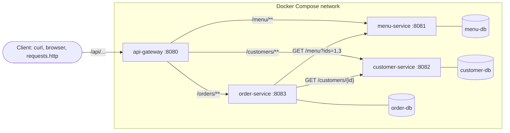

# Campus Canteen: REST microservices in Java

A small, working microservices system for teaching. Four Spring Boot services talk to
each other over REST and run together with Docker Compose. The domain is a campus
canteen: a menu, customers and orders. It is a tiny version of the FTGO food delivery
example in Chris Richardson's *Microservices Patterns* (Manning, 2018).

Use it to learn:

1. how to build a REST API with Spring Boot (controller, service, repository, validation, errors);
2. how one service calls another over REST, and what to do when that call fails;
3. how the pieces become a system: API gateway, database per service, health checks, containers.

It is a boilerplate, not a product. The code is short on purpose. For a hands-on class
session, follow [docs/LAB.md](docs/LAB.md).

## Architecture



- Clients talk only to the **API gateway** on port 8080. It forwards `/api/menu/**`,
  `/api/customers/**` and `/api/orders/**` to the right service and removes `/api`.
- **order-service** is the only service that calls others. To place an order it asks
  customer-service "does this customer exist?" and asks menu-service for all the items
  in **one** batch request (`GET /menu?ids=1,3`), not one request per item.
- Each service has its **own PostgreSQL database**. No service reads another one's tables.

| Service | Port | Owns | Endpoints |
|---|---|---|---|
| api-gateway | 8080 | routing | `/api/**`, `/actuator/gateway/routes` |
| menu-service | 8081 | menu items | `GET /menu`, `GET /menu?ids=1,2,3`, `POST /menu`, `GET/PUT/DELETE /menu/{id}` |
| customer-service | 8082 | customers | `POST /customers`, `GET /customers`, `GET /customers/{id}` |
| order-service | 8083 | orders | `POST /orders`, `GET /orders`, `GET /orders/{id}` |

Ports 8081-8083 are published only for debugging (actuator, Swagger UI). Real clients go
through the gateway.

## What you need

- **JDK 21**, for example Eclipse Temurin 21. Check with `java -version`.
- **Docker** with Compose v2 (Docker Desktop on Windows and macOS). Check with `docker compose version`.
- **curl** (included in Windows 10+, macOS and Linux).
- You do **not** need to install Maven. The Maven Wrapper (`mvnw`, `mvnw.cmd`) downloads
  the right version the first time you run it.
- Optional: IntelliJ IDEA or VS Code. [requests.http](requests.http) works with the
  IntelliJ HTTP Client and the VS Code "REST Client" extension.

## Run it

```bash
./mvnw -q package -DskipTests          # 1. build the four jars
docker compose up -d --build --wait    # 2. build the images, start 7 containers, wait until healthy
scripts/smoke.sh                       # 3. check that everything works, end to end
```

On Windows (cmd or PowerShell):

```
mvnw.cmd -q package -DskipTests
docker compose up -d --build --wait
```

`scripts/smoke.sh` needs bash. On Windows run it from Git Bash or WSL, or use
`requests.http` instead.

The first run takes a few minutes because Maven and Docker download things. After that,
startup takes under a minute. To stop everything and delete the databases:
`docker compose down -v`.

**Why build the jars on your machine and not inside Docker?** Each `Dockerfile` only copies
a finished jar into a small Java runtime image. That keeps the images simple and the
builds fast, and you already have a JDK for development. Many real pipelines build inside
Docker instead (multi-stage builds). Here, simple wins.

### Run one service without Docker

Each service also runs on its own, with an in-memory H2 database:

```bash
./mvnw spring-boot:run -pl menu-service      # Windows: mvnw.cmd spring-boot:run -pl menu-service
curl http://localhost:8081/menu
```

order-service expects menu-service on `localhost:8081` and customer-service on
`localhost:8082`. Change that with the `MENU_SERVICE_URL` and `CUSTOMER_SERVICE_URL`
environment variables.

### Run the tests

```bash
./mvnw verify                                # Windows: mvnw.cmd verify
```

The tests need no Docker. They use H2 and, for order-service, a tiny fake HTTP server.

## Try it

All through the gateway. (On Windows, `requests.http` is easier than quoting JSON in
PowerShell. In PowerShell type `curl.exe`, not `curl`.)

```bash
# The menu: 6 items, Mango Lassi is sold out
curl http://localhost:8080/api/menu

# Two items in one request
curl "http://localhost:8080/api/menu?ids=1,3"

# Register a customer
curl -i -X POST http://localhost:8080/api/customers \
  -H "Content-Type: application/json" \
  -d '{"name": "Asha", "email": "asha@campus.edu"}'

# Place an order: 2 x Masala Dosa (60.00) + 1 x Filter Coffee (20.00)
curl -i -X POST http://localhost:8080/api/orders \
  -H "Content-Type: application/json" \
  -d '{"customerId": 1, "items": [{"menuItemId": 1, "quantity": 2}, {"menuItemId": 3, "quantity": 1}]}'
```

The order comes back like this:

```
HTTP/1.1 201 Created
Location: http://localhost:8080/api/orders/1
Content-Type: application/json

{"id":1,"customerId":1,"placedAt":"2026-11-27T08:00:55.163201553Z",
 "lines":[{"menuItemId":1,"name":"Masala Dosa","unitPrice":60.00,"quantity":2,"lineTotal":120.00},
          {"menuItemId":3,"name":"Filter Coffee","unitPrice":20.00,"quantity":1,"lineTotal":20.00}],
 "total":140.00}
```

Things to notice:

- `Location` points at the gateway (`http://localhost:8080/api/orders/1`), not at the
  container. The gateway sends `X-Forwarded-*` headers and the services use them.
- The order keeps its own **copy** of each item's name and price. If the canteen changes a
  price later, old orders stay correct, and order-service never asks menu-service about the past.
- Errors are RFC 9457 "problem details" (`application/problem+json`). Try an unknown
  customer (422), the sold-out item `"menuItemId": 6` (422), `"quantity": 0` (400) or
  `GET /api/orders/999` (404).

Each service also has Swagger UI on its debug port, for example
<http://localhost:8083/swagger-ui.html>, and the raw OpenAPI document at `/v3/api-docs`.

## Break it: partial failure and the circuit breaker

What happens to orders when menu-service is down?

1. In a second terminal, watch order-service: `docker compose logs -f order-service`
2. Stop menu-service: `docker compose stop menu-service`
3. Place an order (the same curl as above). Within about one second you get:

   ```
   HTTP/1.1 503 Service Unavailable
   Retry-After: 10

   {"detail":"menu-service is unavailable (call failed or timed out)","status":503,
    "title":"Dependency unavailable","service":"menu-service"}
   ```

   It is fast because order-service gives up after its 1 second connect timeout.
   Without a timeout a request could hang for minutes, and every hanging request
   holds one of order-service's threads.
4. Place the order four more times. Now 5 of the last 5 calls failed (the limit is 50%),
   so the circuit breaker **opens**. The log shows
   `Circuit breaker 'menu-service': CLOSED -> OPEN`.
5. Look at it: `curl http://localhost:8083/actuator/circuitbreakers` shows
   `"menu-service":{... "state":"OPEN"}`.
6. Place one more order. The 503 now comes back in a few milliseconds and says
   `circuit breaker is open, call not attempted`. order-service does not even try to
   call menu-service. This protects menu-service while it recovers, and our own threads.
7. Start it again: `docker compose start menu-service`. After 10 seconds the breaker goes
   to `HALF_OPEN` and lets 2 trial calls through. When they succeed it goes back to
   `CLOSED`, and orders work again.

`scripts/smoke.sh` does all of this for you and times the 503.

More things to try:

- `docker compose pause menu-service` freezes the service instead of stopping it. The
  connection opens, but no answer comes. Now the **read timeout** (2 s) protects you.
  Undo with `docker compose unpause menu-service`.
- While menu-service is down, `curl -i http://localhost:8080/api/menu` gives a plain
  `500` from the gateway: the gateway has no fallback of its own. Only order-service,
  which has a circuit breaker, answers helpfully. (Lab exercise 5 fixes this.)
- Stop customer-service instead. Orders fail with a 503 that names customer-service, but
  the menu still works. The failure stays contained.

Where in the code:
[RestClientConfig.java](order-service/src/main/java/com/example/canteen/order/client/RestClientConfig.java) (timeouts),
[MenuClient.java](order-service/src/main/java/com/example/canteen/order/client/MenuClient.java) and
[CustomerClient.java](order-service/src/main/java/com/example/canteen/order/client/CustomerClient.java) (`@CircuitBreaker` and fallback),
`resilience4j:` in [order-service's application.yml](order-service/src/main/resources/application.yml) (the settings),
[ApiExceptionHandler.java](order-service/src/main/java/com/example/canteen/order/controller/ApiExceptionHandler.java) (the 503).

## Project layout

```
.
├── pom.xml                 parent Maven build: versions and the list of modules
├── mvnw, mvnw.cmd, .mvn/   Maven Wrapper
├── docker-compose.yml      4 services + 3 databases
├── requests.http           every endpoint, ready to click
├── scripts/smoke.sh        end-to-end test, including the failure demo
├── Makefile                optional shortcuts
├── docs/LAB.md             hands-on lab for class
├── api-gateway/            Spring Cloud Gateway; the routes are in application.yml
├── menu-service/
│   ├── Dockerfile
│   ├── src/main/java/com/example/canteen/menu/
│   │   ├── controller/     HTTP layer: MenuController, ApiExceptionHandler
│   │   ├── service/        business logic: MenuService
│   │   ├── repository/     Spring Data JPA: MenuItemRepository
│   │   ├── domain/         JPA entity: MenuItem
│   │   └── dto/            request and response records
│   ├── src/main/resources/application.yml
│   └── src/test/java/...   controller test + whole-app test
├── customer-service/       same layout
└── order-service/          same layout, plus client/ (REST clients, timeouts, circuit breakers)
```

Each service is self-contained. Some code is repeated on purpose (each service has its
own `ApiExceptionHandler`): services do not share code, so a team can change one service
without touching the others. A shared library (the book's "microservice chassis", ch. 11)
is a possible next step.

## Patterns from *Microservices Patterns*

| Pattern (book chapter) | What it looks like here | Where in the code |
|---|---|---|
| API Gateway (ch. 8) | One entry point on port 8080. Routes by path and strips `/api`. Clients do not know where services live. | [api-gateway/.../application.yml](api-gateway/src/main/resources/application.yml) |
| Database per service (ch. 1) | menu-db, customer-db and order-db, each with its own user. `Order.customerId` is a plain id, not a foreign key. | `docker-compose.yml`, [Order.java](order-service/src/main/java/com/example/canteen/order/domain/Order.java) |
| Remote procedure invocation, here REST (ch. 3) | order-service calls the others with synchronous HTTP + JSON using Spring's `RestClient`. | [MenuClient.java](order-service/src/main/java/com/example/canteen/order/client/MenuClient.java), [CustomerClient.java](order-service/src/main/java/com/example/canteen/order/client/CustomerClient.java) |
| Circuit breaker (ch. 3) | Resilience4j: judge the last 5 calls, open at 50% failures, stay open 10 s. The fallback answers 503 at once. | `@CircuitBreaker` in the clients; `resilience4j:` in [order-service's application.yml](order-service/src/main/resources/application.yml) |
| Service discovery, provided by the platform (ch. 3) | Docker's DNS resolves `menu-service` to the container's address. Nothing registers itself. | `MENU_SERVICE_URL: http://menu-service:8081` in `docker-compose.yml` |
| Health check API (ch. 11) | Spring Boot Actuator `/actuator/health`. Compose uses it to start things in order and to report `healthy`. | `healthcheck:` in `docker-compose.yml` |
| Externalized configuration (ch. 11) | Database settings, service URLs and timeouts come from environment variables, with local defaults. | each `application.yml`, `environment:` in `docker-compose.yml` |
| Service as a container (ch. 12) | One image per service, built from a jar. | each `Dockerfile` |

Smaller ideas you can point at: a batch read instead of one call per item
(`GET /menu?ids=`), copying the data you need at the time of the order (the price
snapshot in [OrderLine.java](order-service/src/main/java/com/example/canteen/order/domain/OrderLine.java)),
and ignoring JSON fields you do not need (each client has its own small DTO).

## What this boilerplate leaves out

On purpose, to stay small:

- **Security.** No login, no tokens. In the book, the gateway would check an access token
  (ch. 11). The services also trust `X-Forwarded-*` headers. That is only safe when
  nothing but the gateway can reach them; here the debug ports can.
- **Distributed tracing and log aggregation** (ch. 11). Each service logs on its own.
  `docker compose logs` shows them side by side, but nothing ties one request together.
- **Database migrations.** Hibernate creates the tables (`ddl-auto: update`). Real
  projects version their schema with Flyway or Liquibase.
- **Sagas and messaging** (ch. 3 and 4). Placing an order only *reads* from other
  services, so plain REST is enough. Anything that must *change* data in several services
  (reserve stock, charge a card) needs a saga, usually with asynchronous messages. See the
  companion event-driven project (`eda-rabbitmq-java`).
- **Retries, bulkheads and rate limits.** Only timeouts and circuit breakers are here.
  Retries are a lab exercise.
- **Contract tests** (ch. 10) between order-service and the services it calls.
- **Kubernetes.** Compose is enough to show the ideas. Kubernetes adds real load
  balancing, restarts and scaling.
- **A fallback in the gateway.** It answers a plain 500 when a service is down.

## Commands

The `Makefile` has shortcuts. Every one is a single plain command, so you can type it on
Windows too (use `mvnw.cmd` instead of `./mvnw`):

| Shortcut | Plain command | What it does |
|---|---|---|
| `make build` | `./mvnw -q package -DskipTests` | build the four jars |
| `make test` | `./mvnw verify` | run all tests (no Docker) |
| `make up` | `./mvnw -q package -DskipTests` then `docker compose up -d --build --wait` | build and start everything |
| `make smoke` | `scripts/smoke.sh` | end-to-end check of the running system |
| `make logs` | `docker compose logs -f` | follow all logs |
| `make down` | `docker compose down -v` | stop everything, delete the databases |

## Troubleshooting

- **`port is already allocated`**: another program uses 8080-8083. Stop it, or change the
  left number in `ports:` in `docker-compose.yml`, for example `"9080:8080"`.
- **`./mvnw: Permission denied`**: run `chmod +x mvnw`, or `sh mvnw ...`.
- **A container is `unhealthy`**: read its log, for example `docker compose logs menu-service`.
- **You changed code but nothing changed**: rebuild the jar first
  (`./mvnw -q package -DskipTests`), then `docker compose up -d --build`.
- **`429 Too Many Requests` while pulling images**: Docker Hub limits anonymous pulls.
  Wait a little, or run `docker login`.

## Versions

Java 21, Spring Boot 4.2.0, Spring Cloud 2026.0.0 (Gateway 5.1.0), Resilience4j 2.4.0,
springdoc-openapi 3.2.1, PostgreSQL 17, H2 for tests and local runs.

The database users and passwords in `docker-compose.yml` (`menu`/`menu`, ...) are
throwaway values for local development, not secrets.

If you know Spring Boot 3, these Boot 4 changes show up in this code:

- Starters are split by technology: `spring-boot-starter-webmvc` (was `-web`),
  `spring-boot-starter-restclient`, `spring-boot-starter-aspectj` (was `-aop`), and test
  starters such as `spring-boot-starter-webmvc-test`.
- `@WebMvcTest` lives in `org.springframework.boot.webmvc.test.autoconfigure`, and
  `@MockitoBean` replaces `@MockBean`.
- JSON is Jackson 3 (`tools.jackson.*` packages).
- Forwarded headers are set with `server.request.header.forwarded.*`.
- HTTP 422 is `HttpStatus.UNPROCESSABLE_CONTENT`.
- Spring Cloud Gateway properties start with `spring.cloud.gateway.server.webflux.`.
