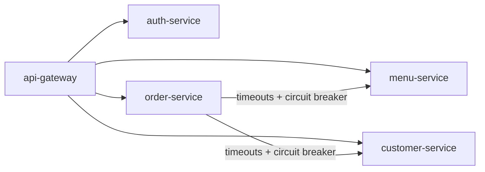

# 1. Defining microservices

This page goes with the first part of the Microservices lecture (slides 3 to 11). Each
idea from the slides is followed by the place in this repo where you can see it.

## Microservices and SOA (slides 3 and 30)

A service-oriented architecture (SOA) builds an application from services that talk over
a network through published interfaces. Microservices are one way to do that. In this
repo each service offers one business capability through a REST API:

| Service | Business capability | API |
|---|---|---|
| menu-service | what the canteen sells, at what price, whether it is sold out | `/menu` |
| customer-service | who may order | `/customers` |
| order-service | placing and reading orders | `/orders` |
| auth-service | who is calling, and what they may do | `/oauth2/token` |
| api-gateway | one entry point for clients | `/api/**` |

What makes them *micro*services and not classic SOA: there is no central enterprise
service bus with business logic in it, each service owns its data, and each one is built
and deployed on its own. Other ways to realize SOA are SOAP web services (WSDL contracts,
often with an enterprise service bus), and remote objects such as CORBA or Java RMI.

## Key concepts (slide 4)

### Service orientation at application level

The canteen is not one application with modules inside. It is several small applications
that call each other over HTTP. order-service never calls a Java method of menu-service;
it sends `GET /menu?ids=1,3`
([MenuClient.java](../order-service/src/main/java/com/example/canteen/order/client/MenuClient.java)).

### Independently deployable

Each service has its own Maven module (its own jar), its own `Dockerfile` (its own image),
its own database and its own configuration. You can rebuild and restart one without
touching the others:

```bash
./mvnw -q package -DskipTests -pl menu-service
docker compose up -d --build menu-service     # only menu-service is replaced
```

order-service keeps working meanwhile, or answers a clear 503 while menu-service restarts.

### Operates on a bounded context

A bounded context is the part of the domain where one model applies. The same word means
different things in different services, and each service keeps its own model:

| Concept | menu-service | order-service |
|---|---|---|
| Menu item | the entity [MenuItem](../menu-service/src/main/java/com/example/canteen/menu/domain/MenuItem.java): name, current price, availability; can be edited | [MenuItemDto](../order-service/src/main/java/com/example/canteen/order/client/MenuItemDto.java) to read the menu, and an [OrderLine](../order-service/src/main/java/com/example/canteen/order/domain/OrderLine.java) that keeps a **snapshot** of name and price at the time of the order |
| Customer | the entity [Customer](../customer-service/src/main/java/com/example/canteen/customer/domain/Customer.java) with name and unique email (in customer-service) | just a `customerId` number in [Order](../order-service/src/main/java/com/example/canteen/order/domain/Order.java), and [CustomerDto](../order-service/src/main/java/com/example/canteen/order/client/CustomerDto.java) with the two fields it reads |

No class is shared between services. If menu-service changes its price later, the order
keeps the old price: in the ordering context, "the price" means "the price you paid".

### Have their own technology stack

| Service | Stack |
|---|---|
| api-gateway | Spring Cloud Gateway on **WebFlux** (reactive, non-blocking, Netty) |
| menu, customer, order | **Spring MVC** on Tomcat (one thread per request), JPA, PostgreSQL |
| auth-service | Spring Security's OAuth 2.0 authorization server, no database |

They are all Java here because one language is easier to teach. Nothing forces that.
menu-service could be rewritten in Go or Python tomorrow. It only has to keep its HTTP
contract, and that contract is now written down and tested: the file
[findItemsByIds.yml](../menu-service/src/test/resources/contracts/order-service/findItemsByIds.yml)
says exactly what order-service sends and needs back (see [TESTING.md](TESTING.md)).

## Microservices and DevOps (slide 5)

Each service is a small deployment unit. The CI pipeline
([ci.yml](../.github/workflows/ci.yml)) builds and tests all of them on every push, runs
the whole system once with Docker Compose, and pushes one image per service to a registry.
A team that owns one service could ship it without waiting for the others.

## Enabling tools and technologies (slide 6)

| Tool | Here |
|---|---|
| Containers for managing deployments | one `Dockerfile` per service, `docker-compose.yml` for the whole system |
| API gateways for managing entry points | `api-gateway`: routing, token checks, one public port |
| Messaging for data sharing | not here: placing an order only reads. See the companion event-driven project, [eda-demo](https://github.com/pradyunuydarp/eda-demo) |

## Characteristics of "micro" (slide 8)

**Size.** You can measure a service by lines of code, by effort, or by functionality.
Here, by lines of Java in `src/main`:

| Service | Lines | Files | Functionality |
|---|---|---|---|
| menu-service | about 340 | 10 | one entity, CRUD and a batch read |
| customer-service | about 240 | 10 | one entity, register and read |
| order-service | about 600 | 20 | one aggregate, two REST clients with timeouts and circuit breakers |
| auth-service | about 60 | 2 | configuration of a ready-made authorization server |
| api-gateway | about 80 | 3 | configuration of a ready-made gateway |

The better measure is functionality: one business capability per service, small enough
for one team to understand completely.

**Implications.**

- *Deployable independently*: see above.
- *Multiple moving parts*: 8 containers instead of 1. Things fail separately, so every
  part needs a way to report and survive failure:
  - a health check per service (`/actuator/health`) and a `healthcheck:` in
    `docker-compose.yml`;
  - `depends_on: condition: service_healthy` to start things in order;
  - timeouts on every call and circuit breakers in order-service, so a failed menu-service
    gives a fast 503 instead of hanging requests (README, "Break it").
- *Service administration overhead*: five images to build, eight containers to watch,
  five logs to read (`docker compose logs`), three databases to back up, two OAuth
  clients to manage. `docker compose ps` shows the state of all of them.

## Why "micro" (slide 9)

| Reason | Where you see it |
|---|---|
| Loose coupling | Services meet only at their HTTP API. Each client has its own small DTO and ignores fields it does not need ("tolerant reader"), so menu-service can add fields without breaking order-service. |
| CI/CD automation | Small units are easy to build, test and ship automatically: [ci.yml](../.github/workflows/ci.yml). |
| Efficient team management | One module per team. The contracts let the menu team change its code without asking the order team, as long as the contract tests pass. |
| Platform heterogeneity | Reactive gateway, servlet services, any language behind an HTTP contract. |

## Important tasks (slide 10)

**Start with familiar functional decomposition.** A canteen has a menu, customers and
orders. Those became the three business services.

**Identify services.**

- *One service per module*: one Maven module each, listed in the root
  [pom.xml](../pom.xml). Each module becomes one jar, one image, one container.
- *Common services*: things every service needs, done once. Here: **api-gateway**
  (routing, token checks) and **auth-service** (tokens for everybody).
- *Manage service dependencies*: know who calls whom, and protect each call.



  The dependencies show up in three places: `depends_on` in `docker-compose.yml` (start
  order only), the timeouts and circuit breakers in order-service (runtime), and the
  contract tests (the API itself).

**Manage the lifecycle.**

- *Develop - test - deploy*: `./mvnw verify` on your machine, the same in CI, then the
  smoke test against the running system, then images in a registry.
- *Change management strategy*: never break a consumer by surprise. A provider changes its
  API only in ways its contracts allow (add fields, add endpoints). A breaking change
  needs a new contract agreed with the consumer first.

## Domain modelling for DB design (slide 11)

There are three options.

| Option | What it means | Good | Bad |
|---|---|---|---|
| **One DB per service** (used here) | menu-db, customer-db, order-db: three PostgreSQL containers, each with its own user | Services are truly independent: own schema, own upgrades, own scaling. A bad query in one cannot slow the others. | More databases to run and back up. No joins or transactions across services; you call APIs instead. |
| One DB per service family | Closely related services share one database, for example menu-service and customer-service | Fewer databases. Related data can be joined. | The services in a family are coupled through their tables: a schema change in one can break the other. They can no longer be deployed fully apart. |
| One DB per application | All services share one database | One database to run. Joins and transactions everywhere. | The database becomes the monolith. Every schema change needs every team. |

This repo uses **one database per service**. `Order.customerId` is a plain number, not a
foreign key, because the customer table is in another database.

How you would change `docker-compose.yml` for the other two options (a sketch; not
wired in):

- *Per service family*: delete `customer-db`. Point customer-service at menu-service's
  database by setting its `SPRING_DATASOURCE_URL` to `jdbc:postgresql://menu-db:5432/menu`
  and its user and password to `menu`/`menu`, and change `depends_on` to `menu-db`.
  Both services now create their tables (`menu_item`, `customer`) in one database.
- *Per application*: replace the three databases with one `canteen-db` (database
  `canteen`, user `canteen`) and point all three services at
  `jdbc:postgresql://canteen-db:5432/canteen`.

Nothing in the Java code changes, because the table names do not clash. That is the
danger: nothing stops menu-service from reading the `orders` table now, and soon the
services are coupled through the database instead of their APIs.

Note that api-gateway and auth-service have no database at all. auth-service keeps its
clients in configuration and its signing key in memory.
