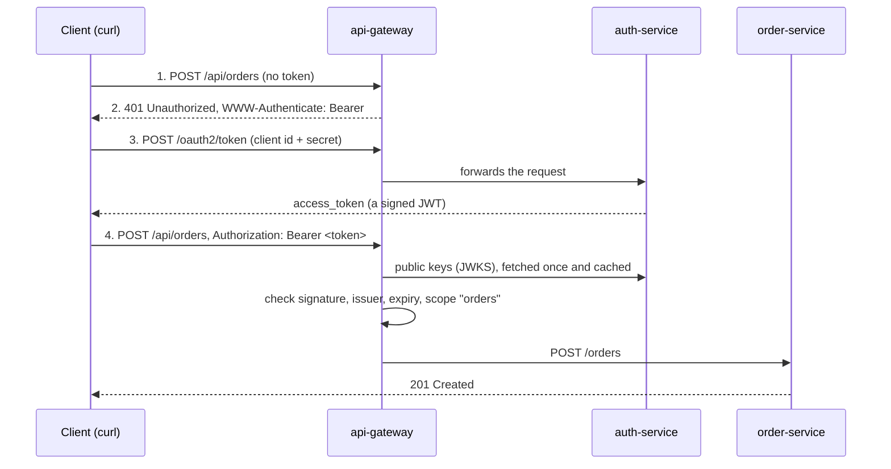

# 2. Securing microservices

This page goes with the second part of the Microservices lecture (slides 13 to 17).
The lecture names three layers: the service, the containers and the infrastructure.

## Layer 1: securing the service with OAuth 2.0 (slides 14 and 15)

Without a common approach, every service would implement its own login and its own
rules, five times, slightly differently. OAuth 2.0 avoids that: one **security service**
for the whole organization issues **access tokens**, and every other service only has to
check them.

| OAuth 2.0 role | In this repo |
|---|---|
| Authorization server (the security service) | **auth-service** (port 8090), built on Spring Security's authorization server |
| Client (the program that wants to call an API) | `canteen-app` (orders and customers) and `canteen-admin` (may also change the menu) |
| Resource server (checks tokens before serving) | **api-gateway**, for every service behind it |
| Access token | a JWT, signed by auth-service with an RSA key |
| Scope (what the token allows) | `orders`, `customers`, `menu.write` |

The clients use the **client credentials** grant: the client sends its id and secret and
gets a token. That fits programs talking to programs. When people log in (a student in a
browser), you would use the authorization code grant, and the token would also say which
person it belongs to.

### The typical flow, step by step

Start the system (`docker compose up -d --build --wait`) and follow along.



**Step 1. The client makes a service call.**

```bash
curl -i -X POST http://localhost:8080/api/orders \
  -H "Content-Type: application/json" \
  -d '{"customerId": 1, "items": [{"menuItemId": 1, "quantity": 1}]}'
```

```
HTTP/1.1 401 Unauthorized
WWW-Authenticate: Bearer
```

**Step 2. The auth service intercepts.** In this repo the interception has two halves.
The gateway stops every call that has no valid token (above) and tells the client to
bring a bearer token. auth-service then decides who gets one: it checks the client's id
and secret, and which scopes the client may have. A wrong secret:

```bash
curl -i -u canteen-app:wrong-secret -d grant_type=client_credentials \
  -d "scope=orders customers" http://localhost:8080/oauth2/token
```

```
HTTP/1.1 401 Unauthorized

{"error":"invalid_client"}
```

**Step 3. The auth service creates a token (the lecture's SECURITY_TOKEN) and returns it.**

```bash
curl -s -u canteen-app:canteen-app-secret -d grant_type=client_credentials \
  -d "scope=orders customers" http://localhost:8080/oauth2/token
```

```json
{"access_token":"eyJraWQiOiJhZGI1...","scope":"orders customers","token_type":"Bearer","expires_in":3599}
```

The client asks for the scopes it needs. If it asks for none, the token carries none. If
it asks for one it was not given (`canteen-app` asking for `menu.write`), the answer is
`400 {"error":"invalid_scope"}`.

The access token is a JWT: three Base64 parts separated by dots (header, claims,
signature). Decoded, the middle part looks like this:

```json
{"sub":"canteen-app","aud":"canteen-app","scope":["orders","customers"],
 "iss":"http://auth-service:8090","iat":1795773598,"nbf":1795773598,"exp":1795777198,"jti":"4c99506c-..."}
```

Anyone can read it (it is encoded, not encrypted). Nobody can change it without breaking
the signature, which only auth-service's private key can make. To see it yourself:

```bash
TOKEN=$(curl -s -u canteen-app:canteen-app-secret -d grant_type=client_credentials \
  -d "scope=orders customers" http://localhost:8080/oauth2/token \
  | sed -n 's/.*"access_token":"\([^"]*\)".*/\1/p')
cut -d. -f2 <<<"$TOKEN" | tr '_-' '/+' | base64 -d 2>/dev/null; echo
```

(`base64` may complain about missing `=` padding at the end; the JSON still prints.)

**Step 4. The client calls the actual service with the token.**

```bash
curl -i -X POST http://localhost:8080/api/customers \
  -H "Authorization: Bearer $TOKEN" -H "Content-Type: application/json" \
  -d '{"name": "Asha", "email": "asha@campus.edu"}'
curl -i -X POST http://localhost:8080/api/orders \
  -H "Authorization: Bearer $TOKEN" -H "Content-Type: application/json" \
  -d '{"customerId": 1, "items": [{"menuItemId": 1, "quantity": 1}]}'
```

Both answer `201 Created`. Before forwarding, the gateway checked that the token

1. is signed by auth-service: it fetches auth-service's public keys once from
   `http://auth-service:8090/oauth2/jwks` and caches them;
2. was issued by `http://auth-service:8090` (the `iss` claim);
3. has not expired (the `exp` claim; tokens live 1 hour here);
4. has the scope the route needs.

A valid token with the wrong scope gives **403**:

```bash
curl -i -X POST http://localhost:8080/api/menu -H "Authorization: Bearer $TOKEN" \
  -H "Content-Type: application/json" -d '{"name": "Idli", "price": 30.00, "available": true}'
```

```
HTTP/1.1 403 Forbidden
WWW-Authenticate: Bearer error="insufficient_scope", error_description="The request requires higher privileges than provided by the access token.", ...
```

The canteen manager's client may change the menu:

```bash
ADMIN_TOKEN=$(curl -s -u canteen-admin:canteen-admin-secret -d grant_type=client_credentials \
  -d "scope=menu.write" http://localhost:8080/oauth2/token \
  | sed -n 's/.*"access_token":"\([^"]*\)".*/\1/p')
curl -i -X POST http://localhost:8080/api/menu -H "Authorization: Bearer $ADMIN_TOKEN" \
  -H "Content-Type: application/json" -d '{"name": "Idli", "price": 30.00, "available": true}'
```

That gives `201 Created`. 401 means "who are you?"; 403 means "I know who you are, and
you may not do this".

### Where it is in the code

- [auth-service/src/main/resources/application.yml](../auth-service/src/main/resources/application.yml):
  the issuer, the two clients, their secrets, scopes and token lifetime. Spring Boot
  builds the authorization server from these properties.
- [auth-service/.../SecurityConfig.java](../auth-service/src/main/java/com/example/canteen/auth/SecurityConfig.java):
  turns on the OAuth 2.0 endpoints (`http.oauth2AuthorizationServer(...)`) and closes
  everything else except the health check.
- [api-gateway/.../SecurityConfig.java](../api-gateway/src/main/java/com/example/canteen/gateway/SecurityConfig.java):
  the rules (which route needs which scope).
- `spring.security.oauth2.resourceserver.jwt` in
  [api-gateway's application.yml](../api-gateway/src/main/resources/application.yml):
  where the public keys are and which issuer to accept.
- The `auth-service` route in the same file: clients fetch tokens through the gateway,
  so the gateway stays the single entry point.

Tests: [TokenEndpointTest](../auth-service/src/test/java/com/example/canteen/auth/TokenEndpointTest.java)
(a valid client gets a signed JWT with the right issuer and scopes; a bad secret gets 401;
a scope the client does not have gets 400) and
[GatewaySecurityTest](../api-gateway/src/test/java/com/example/canteen/gateway/GatewaySecurityTest.java)
(every rule above, plus tokens with a wrong issuer, a wrong signature or an expired date).

### A fixed issuer

Every token says `"iss":"http://auth-service:8090"`, whether you fetched it through the
gateway (`localhost:8080`) or from auth-service's debug port (`localhost:8090`). The
issuer is a fixed name in configuration (`AUTH_ISSUER`), not taken from the request.
Otherwise the same server would issue tokens with different issuers, and the gateway
would reject some of them.

### Signing keys live in memory

Spring Boot makes a new RSA key pair every time auth-service starts. After a restart, old
tokens stop working as soon as the gateway sees a token signed with the new key and
reloads the public keys. A real authorization server keeps its keys in a key store,
publishes the next key before using it, and retires old ones slowly (key rotation).

### Dev-only secrets

`canteen-app-secret` and `canteen-admin-secret` are written in plain text
(`{noop}`) in auth-service's `application.yml`, so everyone in class can use them. They
are not secrets and protect nothing. A real deployment:

- stores only a hash (`{bcrypt}...`), never the plain secret;
- takes it from a secret store at startup (a Kubernetes Secret, Vault, a cloud secret
  manager), for example through the `CANTEEN_APP_SECRET` environment variable;
- gives tokens a short life (minutes, not an hour).

### Perimeter security or zero trust

Only the gateway checks tokens. The services behind it accept any request that reaches
them, because in production only the gateway should be able to reach them. This is
**perimeter security**: one strong wall at the edge.

- Good: one place to configure and audit; the services stay simple.
- Bad: one hole in the wall bypasses every check. Here the debug ports are such a hole:
  `curl -X POST http://localhost:8083/orders ...` places an order with no token at all.
  An attacker inside the network can do the same.

The alternative is **zero trust**: every service checks the token itself.

1. The gateway already forwards the `Authorization` header to the services.
2. Make each service a resource server: add `spring-boot-starter-security-oauth2-resource-server`,
   the same `jwk-set-uri` and `issuer-uri` settings as the gateway, and its own rules
   (for example menu-service: `POST /menu` needs `menu.write`).
3. order-service calls menu-service and customer-service itself. It either passes on the
   caller's token (token relay: copy the incoming `Authorization` header in a `RestClient`
   interceptor), or gets its own token from auth-service as a client of its own (service
   identity).
4. Optionally add mutual TLS between services, so they also know which service is calling.

That is more work and more configuration in every service, but a single hole no longer
opens everything. Try it in lab exercise 6.

## Layer 2: securing the containers (slide 16)

"Container sprawl": 8 containers are 8 things to attack. Treat each like a small server.

What this repo does:

- **Small images with only what is needed**: each image is `eclipse-temurin:21-jre-alpine`
  (a Java runtime, no compiler, no Maven, no shell tools beyond Alpine's basics) plus one jar.
- **Not root**: every `Dockerfile` creates a user `app` and switches to it (`USER app`).
- **Hardening in `docker-compose.yml`**, on every Java service:

  ```yaml
  security_opt: [no-new-privileges:true] # no process can gain more rights later
  cap_drop: [ALL]                         # no Linux capabilities; a web app needs none
  read_only: true                         # the container's file system cannot be changed...
  tmpfs: [/tmp]                           # ...except /tmp, in memory (Tomcat needs it)
  ```

  Check it: `docker compose exec menu-service touch /app/x` fails with
  `Read-only file system`.
- **Secure coding**: inputs are validated (Bean Validation on every request record),
  errors are problem details without stack traces, and the SQL is generated by JPA with
  bind parameters, so there is no SQL injection through string concatenation.

What a real deployment adds:

- **Scan the packages in the images** for known vulnerabilities, in CI and regularly:
  `docker scout cves microservices-demo-menu-service` or
  `trivy image microservices-demo-menu-service`. A new CVE in the JRE or in Alpine means
  rebuilding every image.
- Pin base images by digest, rebuild them often, sign images and check signatures before
  running them.
- Limit memory and CPU per container, so one runaway service cannot starve the others.
- Secure the hosts that run the containers: patched OS and Docker, nobody but admins in
  the `docker` group (it is equal to root).

## Layer 3: securing the infrastructure (slide 17)

This is not special to microservices; it is normal enterprise security.

| Practice | Here | Real deployment |
|---|---|---|
| Firewall | The databases publish no ports. But 8081-8083 and 8090 are published for class. | Publish only the gateway. Remove the debug `ports:` (or bind them to `127.0.0.1`), and let a firewall or cloud security group allow only 443. |
| SSL/TLS | None: plain HTTP on your machine. Tokens and secrets travel in clear text. | TLS at the edge (a reverse proxy, a load balancer or a Kubernetes ingress with a certificate from Let's Encrypt), and ideally TLS between services too. Bearer tokens must never travel without TLS. |
| Gateway / reverse proxy | api-gateway: one entry point, checks tokens, hides where services live. | The same, behind a TLS-terminating proxy, with rate limits. |
| Anti-virus and host security | Not covered. | Hardened, patched hosts; malware scanning; audit logs. |
