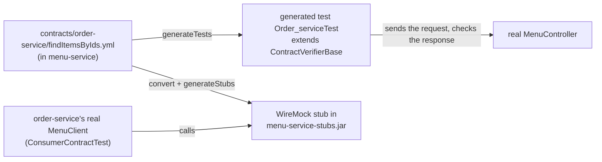

# 3. Testing microservices

This page goes with the third part of the Microservices lecture (slides 19 to 22).

## The essentials (slide 19)

- **Test automation.** Every test here runs with one command, on your machine and in CI:

  ```bash
  ./mvnw verify          # all modules, all tests (Windows: mvnw.cmd verify)
  scripts/smoke.sh       # end to end, against the running system
  ```

  Use `verify`, not `test`. The contract stubs jars are built in Maven's `package` phase,
  which `test` never reaches, so order-service's `ConsumerContractTest` cannot start
  after `./mvnw test`. For one module and the modules it needs:
  `./mvnw verify -pl order-service -am`.
- **Stubs and drivers**: see below.
- **Several test types**, from many small fast tests to a few big slow ones.
- **Contract testing**, with Spring Cloud Contract.

## The test types, with this repo's tests

| Type | What it checks | Test classes | Speed |
|---|---|---|---|
| **Unit** | One class. Its collaborators are mocks. | [OrderServiceTest](../order-service/src/test/java/com/example/canteen/order/OrderServiceTest.java) (plain Mockito, no Spring). The web-layer tests `MenuControllerTest`, `CustomerControllerTest`, `OrderControllerTest` (`@WebMvcTest`: controller, JSON, validation; the service is a mock). | milliseconds |
| **Component** | One whole service, alone. The services it calls are replaced by stubs. | [DownstreamCallsTest](../order-service/src/test/java/com/example/canteen/order/DownstreamCallsTest.java) (order-service against a fake menu- and customer-service that can fail or be slow), `ConsumerContractTest.placesOrderAgainstTheStubs`, `MenuServiceApplicationTest` and `CustomerServiceApplicationTest` (whole service on H2), [TokenEndpointTest](../auth-service/src/test/java/com/example/canteen/auth/TokenEndpointTest.java), [ApiGatewayRoutesTest](../api-gateway/src/test/java/com/example/canteen/gateway/ApiGatewayRoutesTest.java) and [GatewaySecurityTest](../api-gateway/src/test/java/com/example/canteen/gateway/GatewaySecurityTest.java) (the gateway with `FakeBackend` behind it) | seconds |
| **Integration** | Our code together with real infrastructure. | [CustomerRepositoryPostgresTest](../customer-service/src/test/java/com/example/canteen/customer/CustomerRepositoryPostgresTest.java): the repository against a real PostgreSQL 17 in Docker (Testcontainers). Skipped without Docker. | seconds |
| **Contract** | That a provider and its consumer agree on the HTTP API. | Provider side: `Order_serviceTest` in menu-service and customer-service, generated from the YAML contracts. Consumer side: [ConsumerContractTest](../order-service/src/test/java/com/example/canteen/order/ConsumerContractTest.java) in order-service. | seconds |
| **End-to-end** | The whole system, through the gateway, in containers. | [scripts/smoke.sh](../scripts/smoke.sh); the `smoke` job in [ci.yml](../.github/workflows/ci.yml) | a minute |

`./mvnw verify` runs 75 tests: menu-service 10, customer-service 12, order-service 22,
auth-service 6, api-gateway 25.

Why so many kinds? Each one catches problems the others cannot:

- Unit tests run in milliseconds, so you can have hundreds. They cannot see wiring,
  configuration, JSON or HTTP.
- Component tests start the real service with its real configuration, so they catch
  wiring mistakes, wrong timeouts and wrong security rules. They still do not know whether
  the real menu-service answers the way the stub does.
- Integration tests catch "works on H2, fails on PostgreSQL".
- Contract tests catch "the stub and the real provider disagree" without starting both.
- End-to-end tests catch everything else (Dockerfiles, Compose, network, the real
  gateway), but they are slow and when they fail they do not tell you where.

## Stubs and drivers (slide 21)

A **stub** is a dummy implementation of a service that the service under test depends on.
It answers the way the real one would, or fails on purpose.

| Stub | Stands in for | Used by |
|---|---|---|
| A tiny JDK `HttpServer` with `/menu` and `/customers/` | menu-service and customer-service; it can return 500 or be slow on demand | `DownstreamCallsTest` (timeouts, 503, circuit breaker) |
| WireMock stubs generated from the contracts, started by Stub Runner on ports 18081 and 18082 | menu-service and customer-service, exactly as the contracts say | `ConsumerContractTest` |
| `FakeBackend`, which echoes the path it receives and serves a test JWKS | every service behind the gateway, and auth-service's public keys | `ApiGatewayRoutesTest`, `GatewaySecurityTest` |
| Mockito mocks (`@MockitoBean MenuService`, `mock(MenuClient.class)`) | a class inside the same service | unit tests, the contract base classes |

A **driver** strings calls together into a realistic flow and checks the results.

| Driver | Drives |
|---|---|
| `scripts/smoke.sh` | the whole system: public menu, 401 without a token, token request, 403 with the wrong scope, customer, order, 422 rules, stopping menu-service, the circuit breaker opening and closing |
| `MockMvc` and `WebTestClient` in the tests | one service, without a real network |
| [requests.http](../requests.http) | a manual driver: every endpoint, one click each |

## The automated testing lifecycle (slide 20)

Every test has four phases:

1. **Setup**: prepare what the test needs (data, a token, a stopped service, a database).
2. **Execute**: run the thing under test.
3. **Verify**: compare the result with what you expect: pass or fail.
4. **Teardown**: clean up, so the next test starts fresh. Also when the test failed.

Where to see them labelled:

- [scripts/smoke.sh](../scripts/smoke.sh): `# Setup`, `# Execute`, `# Verify`, `# Teardown`
  comments, and a `teardown` function that runs on exit (`trap teardown EXIT`). If a check
  fails while menu-service is stopped, the teardown still starts it again.
- [CustomerRepositoryPostgresTest](../customer-service/src/test/java/com/example/canteen/customer/CustomerRepositoryPostgresTest.java):
  Setup starts PostgreSQL once for the class and saves a customer; Execute runs the query;
  Verify checks the answer and that it really was PostgreSQL; Teardown is a rollback after
  each test and removing the container after the last one.
- [ConsumerContractTest](../order-service/src/test/java/com/example/canteen/order/ConsumerContractTest.java):
  Stub Runner starts the WireMock servers before the tests (Setup) and stops them after
  (Teardown).

In JUnit, `@BeforeEach` and `@BeforeAll` are Setup, the test method is Execute and
Verify, and `@AfterEach` and `@AfterAll` are Teardown. Spring and Testcontainers do much
of the Setup and Teardown for you.

## Contract testing (slide 22)

Services talk through contracts. A contract test checks:

- the HTTP method and path,
- the request headers,
- the request body,
- the response: status code, headers and body.

This repo uses **Spring Cloud Contract**, the tool *Microservices Patterns* uses in
chapter 10, for both pairs where one service calls another:

| Consumer | Provider | Contract |
|---|---|---|
| order-service | menu-service | [findItemsByIds.yml](../menu-service/src/test/resources/contracts/order-service/findItemsByIds.yml): `GET /menu?ids=1,3` with `Accept: application/json` gives `200` and two items with `id`, `name`, `price`, `available` |
| order-service | customer-service | [findCustomer.yml](../customer-service/src/test/resources/contracts/order-service/findCustomer.yml): `GET /customers/1` gives `200` with `id` and `name` |
| order-service | customer-service | [unknownCustomer.yml](../customer-service/src/test/resources/contracts/order-service/unknownCustomer.yml): `GET /customers/999` gives `404` |

Both calls are `GET`s, so there is no request body to check. A contract for `POST /orders`
would pin the JSON body too.

The contracts are **consumer-driven**: they say what order-service sends and what it
reads, nothing more. customer-service also returns `email`, but order-service does not
read it, so the contract does not mention it, and customer-service may change it freely.

### How one YAML file becomes two tests



**Provider side** (menu-service, customer-service). The `spring-cloud-contract-maven-plugin`
in their `pom.xml`:

1. generates one JUnit test class per consumer folder, here `Order_serviceTest`, into
   `target/generated-test-sources/contracts`. It sends each contract's request to the real
   controller and checks the response against the contract. The class extends
   `ContractVerifierBase` (in `src/test/java/.../contracts/`), which mocks the service
   layer with the data the contracts use;
2. turns each contract into a WireMock mapping and packs them into
   `target/<service>-stubs.jar` (Maven classifier `stubs`).

If menu-service breaks the contract, its own build fails, before order-service is hurt.

**Consumer side** (order-service). Its `pom.xml` has a test dependency on the two stubs
jars. `ConsumerContractTest` uses
`@AutoConfigureStubRunner(stubsMode = CLASSPATH, ids = "com.example.canteen:menu-service:+:stubs:18081", ...)`:
Stub Runner finds the stubs on the classpath and starts WireMock on ports 18081 and
18082. The real `MenuClient` and `CustomerClient` then call those ports. If order-service
sends something the contract does not allow, WireMock answers 404 "Request was not
matched", and the test fails.

This already caught one real mismatch while the tests were written: the contracts said
order-service sends `Accept: application/json`, but its `RestClient` calls sent
`Accept: */*`. The fix was one line in each client: `.accept(MediaType.APPLICATION_JSON)`.

In a company the stubs jars would be published to a Maven repository, and the consumer
team would download them from there. Here, in one Maven build, the reactor passes them
from module to module, which is why `verify` (or `package`) is needed.

Try both directions of breaking a contract in [LAB.md](LAB.md), Part 6.
